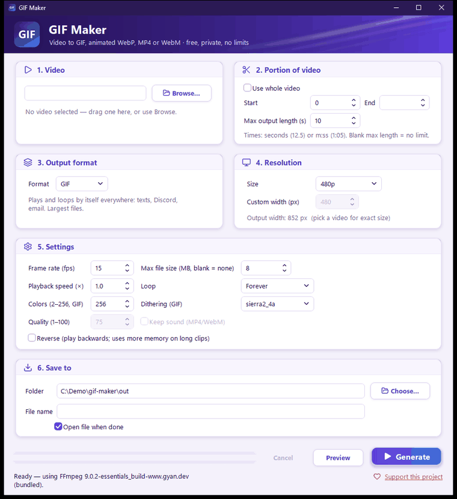

# GIF Maker

**Free, offline alternative to online video-to-GIF converters. No upload limits, no watermark, no account.**



Turns a video file into a GIF, or a much smaller animated WebP, MP4 or WebM, in a desktop
window. Drag a video onto the window, or click Browse. Your video never leaves your computer.
Works on Windows and macOS.

## Download
Get the latest version from the [Releases page](https://github.com/collinb0607/gif-maker/releases/latest).
Nothing else to install: FFmpeg is built in.

| Your computer | Download | First launch |
|---|---|---|
| Windows 10/11 | `GIF-Maker-Windows.exe` | Windows may show "Windows protected your PC" because the app isn't signed. Click **More info**, then **Run anyway**. The first start takes a few seconds. |
| Mac with Apple Silicon (M1 or newer) | `GIF-Maker-macOS.zip` | Unzip, then open **GIF Maker**. macOS blocks it the first time because the app isn't notarized: open **System Settings → Privacy & Security**, scroll down and click **Open Anyway**. |

On an Intel Mac, or any other system, run it from source with Python (below).

## Run from source (Python)
### Setup (one time)
1. Install **Python 3.8+** from https://python.org. On Windows, tick **"Add Python to PATH"** during install.
2. Run the app (see below). The first time, it checks for what it needs and asks
   **"Install required components?"** Click **Yes**. It downloads:
   - `imageio-ffmpeg`, which includes FFmpeg, the video engine, so you don't have to install it separately
   - `pillow`, which powers the preview
   - `tkinterdnd2`, for dragging a video onto the window (optional: **Browse** works without it)

   This takes about a minute (30–60 MB). The app then shows **"Installed! Using FFmpeg …"** at the bottom.
   You won't be asked again.

The status line at the bottom always shows which FFmpeg the app is using. The app
ignores copies of FFmpeg that are too old, such as ones bundled with other
programs.

### Run
```
python gif_maker.py        # Windows
python3 gif_maker.py       # macOS
```
On Windows you can also just double-click `gif_maker.py`. If you have more than one Python installed,
double-clicking can run a different one from `python` in a terminal, so it may ask to install the
components once more. The install dialog shows which Python it installs into.

## Troubleshooting
- **Automatic install failed:** the error dialog shows the exact command to run in a
  terminal. It looks like this, using the path of the Python that runs the app:
  ```
  "C:\Path\To\python.exe" -m pip install imageio-ffmpeg pillow tkinterdnd2
  ```
  Use that exact command rather than a plain `pip install`. If you have more than one Python
  installed, `pip` may install into a different one than the one that runs the app.
- **"Couldn't read video: …"** under the file box: the message gives the reason. "Incomplete or
  damaged" usually means the recording was interrupted or is still being written.
- **A format is greyed out or shows "can't make … files":** that FFmpeg build is missing the
  encoder for it. The FFmpeg that the app installs includes all four.
- **GIF is bigger than the video:** this is normal. MP4 compression only stores what changes
  between frames. GIF stores each frame as a separate image with at most 256 colors, so it
  is often 5–20× larger than the source video. To shrink it, these help most, in order:
  **lower resolution** (480p is about ¼ the size of 1080p), **set Max file size**,
  **lower fps**, **shorter clip**, **fewer colors**, then **Dithering: none or bayer**.
  Or switch to **WebP**, about 3–5× smaller, or **MP4**, often 10× smaller or more.
- **Reverse uses more memory:** it has to hold the whole clip in memory. On long or
  high-resolution clips, use a lower resolution or a shorter section.
- **Something fails with no message:** errors are also written to `gif_maker_errors.log` in
  your temp folder. On Windows, paste `%TEMP%\gif_maker_errors.log` into File Explorer's
  address bar. On Mac, run `open $TMPDIR/gif_maker_errors.log`. Running the app from a terminal
  with `python gif_maker.py` also shows errors there.
- **"No module named tkinter" on a Mac with Homebrew Python:** run `brew install python-tk`.

## Which format should I use?
| Format | Plays by itself? | Size | Best for |
|---|---|---|---|
| **GIF** | Yes, loops everywhere | Largest | Texts (iMessage, RCS), Discord, email: anywhere it must just play |
| **WebP** | Yes, where supported | ~3–5× smaller than GIF | Websites and Discord. Not dependable in email or texts |
| **MP4** | Usually tap-to-play in chat apps | Smallest | Sharing a clip where size matters more than auto-play. Websites and social media that autoplay muted video |
| **WebM** | Tap-to-play | Similar to MP4 | Discord and the web. iPhones often can't play it |

**If you want it to auto-play and loop in a chat, use GIF.** MP4 is far smaller, but most
chat apps show it as a video you tap to play.
App support changes over time, so try a quick test send if it matters.

## Options
| Option | What it does |
|---|---|
| Use whole video / Start / End | Pick which part of the video to use (`12.5` or `1:05` format) |
| Max output length | Limits how long the result plays, in seconds |
| Format | GIF, WebP, MP4 or WebM (see above). The file name's extension follows the choice |
| Resolution | Original, 1080p down to 144p, or a custom width. Shows the exact output size and never upscales |
| Frame rate | Frames per second. 10–15 looks smooth for GIF/WebP. Video formats can go higher cheaply |
| Max file size | Re-encodes until the file fits. GIF: shrinks width, then fps. WebP: lowers quality, then shrinks. MP4/WebM: works out the right bitrate from the limit |
| Playback speed | 2 = twice as fast, 0.5 = slow motion. Sound keeps its pitch |
| Loop | GIF/WebP only: forever, play once, or a set number of plays. Videos loop if the app playing them does |
| Colors / Dithering | GIF only. Fewer colors means a smaller file. `bayer` or `none` dithering also helps |
| Quality | WebP/MP4/WebM, 1–100. Lower means a smaller file |
| Keep sound | MP4/WebM only, when the video has sound |
| Reverse | Plays the clip backwards (sound too) |
| Save to / File name | Where the file goes |
| **Preview** | Makes the file and plays it in a window, opened over the main window on the same monitor, with its file size, dimensions, frame count and length. The preview is silent. **Save this …** saves that exact file, so it isn't made again |
